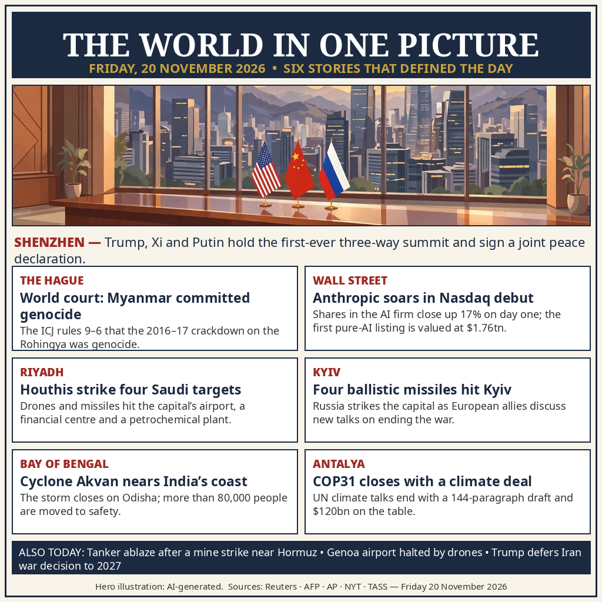

# news-image-20261120

[](https://make.fun/bounty/news-image-20261120?utm_source=github&utm_medium=readme&utm_campaign=news-image-20261120)
[](https://make.fun/bounty/news-image-20261120/leaderboard?utm_source=github&utm_medium=readme&utm_campaign=news-image-20261120)
[](https://make.fun/bounty/news-image-20261120?utm_source=github&utm_medium=readme&utm_campaign=news-image-20261120)

One image summing up the world news of **Friday, 20 November 2026**:
a drawn newspaper-style poster naming the day, with six major stories
from six regions and fields, plus an "also today" strip.



## The stories

1. **Shenzhen** — Trump, Xi and Putin hold the first-ever three-way
   summit and sign a joint peace declaration.
2. **The Hague** — The ICJ rules 9–6 that Myanmar committed genocide
   against the Rohingya in 2016–17.
3. **Wall Street** — Anthropic's shares close up 17% on their Nasdaq
   debut; the first pure-AI listing is valued at $1.76tn.
4. **Riyadh** — Houthi drones and missiles strike four Saudi targets,
   including the capital's airport.
5. **Kyiv** — Four ballistic missiles hit the capital as European
   allies discuss new talks on ending the war.
6. **Bay of Bengal** — Cyclone Akvan nears India's Odisha coast;
   more than 80,000 people moved to safety.

Also today: a tanker ablaze after a mine strike near the Strait of
Hormuz; Genoa airport halted by unidentified drones; Trump defers the
Iran war decision to 2027. Sources and dating notes are in
[RESEARCH.md](RESEARCH.md).

## How it works

- `entry.png` — the finished poster (1024 x 1024).
- `hero.jpg` — the AI-generated summit-hall illustration used in the
  poster's hero panel (no people, no text).
- `render_poster.py` — the script that composes the poster with PIL
  and the Noto Sans / Noto Serif fonts. Run it with
  `python3 render_poster.py` to regenerate `entry.png`.
- `main.ts` — the competition entrypoint (Node 22, standard library
  only). It verifies the PNG signature and copies `entry.png` to
  `/output/entry.png`, or to `$MAKEFUN_OUTPUT_DIR/entry.png` for a
  local run. It writes identical bytes on every run.

Local check:

```sh
mkdir -p out && MAKEFUN_OUTPUT_DIR=out node main.ts
```

## License

MIT — see [LICENSE](LICENSE).

---

Built for the make.fun bounty "Sum up 20 November's world news in one image". Referral code: 3a433hx8
